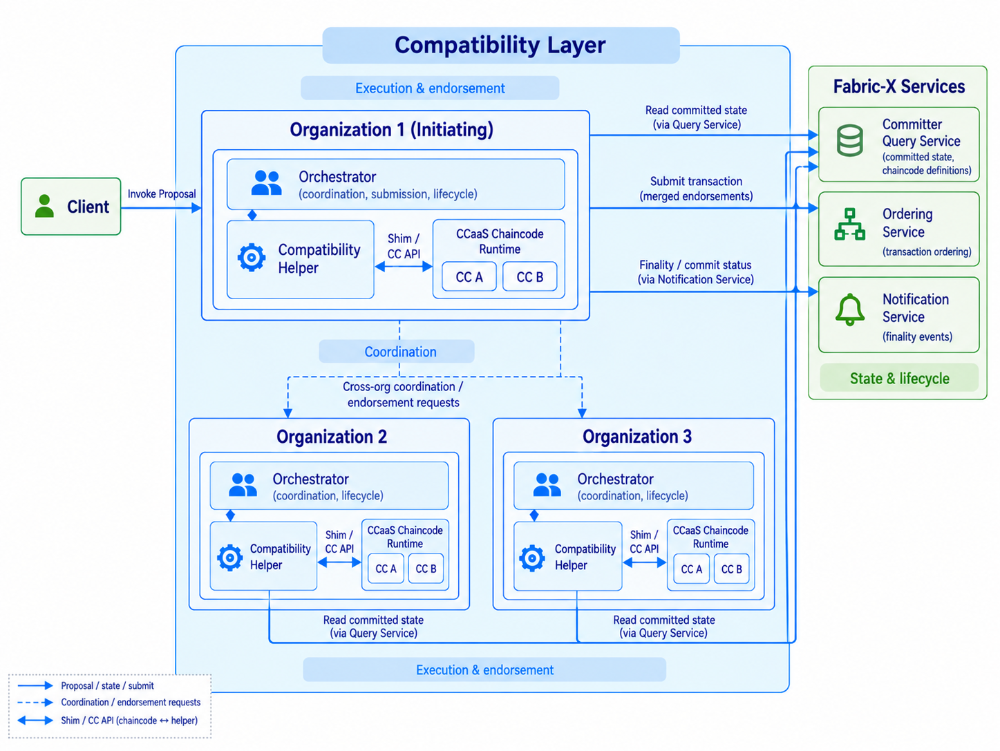

- Feature Name: Fabric-X Chaincode Compatibility
- Start Date: 2026-10-14
- RFC PR:
- Fabric-X Component: fabric-x-chaincode-compatibility
- Fabric-X Issue:

# Summary
[summary]: #summary

This proposal introduces a compatibility layer that enables existing Hyperledger Fabric chaincodes to run on Fabric-X without modifying their business logic. It provides an execution environment that translates Fabric chaincode operations into Fabric-X transactions, while supporting multi organization endorsement, chaincode lifecycle management, and pluggable orchestrator discovery. The goal is to simplify migration from Fabric to Fabric-X while preserving the existing chaincode programming model.

# Motivation
[motivation]: #motivation

Fabric-X introduces a modular transaction processing architecture designed for improved performance and scalability. However, unlike traditional Hyperledger Fabric, it does not provide a native chaincode execution environment. Organizations with existing Fabric applications therefore face significant migration challenges, as their chaincodes cannot be directly executed on Fabric-X without additional infrastructure or modifications.

To encourage Fabric-X adoption, organizations need a simpler way to migrate without rebuilding their existing applications. The compatibility layer addresses this by allowing existing Fabric chaincodes to work with Fabric-X with minimal changes.This allows organizations to preserve their existing chaincode business logic while adopting Fabric-X's transaction processing model, reducing migration complexity and development effort.

The compatibility layer addresses this gap by reusing the existing Fabric chaincode shim protocol and connecting chaincode execution to Fabric-X services.

The main objectives are:

- Run existing Go chaincodes using Chaincode-as-a-Service (CCaaS).
- Support multi organization execution and endorsement.
- Provide Fabric compatible chaincode lifecycle operations.
- Allow pluggable discovery and integration with Fabric-X components.
- Support transaction coordination, duplicate detection, and finality tracking.

Together, these capabilities aim to simplify migration while preserving familiar Fabric workflows and leveraging Fabric-X's transaction processing model.

# Guide-level explanation
[guide-level-explanation]: #guide-level-explanation

The compatibility layer allows developers to reuse existing Fabric chaincodes on Fabric-X while retaining familiar deployment and invocation workflows.

The architecture consists of the following components:

| Component | Responsibility |
|---|---|
| **Orchestrator** | Coordinates execution across organizations, collects endorsements, and submits transactions |
| **Compatibility Helper** | Handles Fabric shim communication and translates chaincode state requests into Fabric-X-compatible operations |
| **Chaincode Service** | Hosts and executes existing Fabric chaincodes as independent CCaaS services |
| **Lifecycle Manager** | Manages chaincode installation, organizational approvals, and committed definitions |
| **Discovery Resolver** | Locates and selects Orchestrator instances through configurable discovery mechanisms |

## Chaincode execution

Consider an existing Fabric application that uses chaincode to manage assets. With the compatibility layer, developers can deploy the same chaincode as an external service and continue invoking its existing functions.

For example, an asset-transfer operation can continue using familiar shim APIs such as `GetState`, `PutState`, and `DelState` to retrieve an asset, change its ownership, and update its state. Developers do not need to rewrite this business logic using Fabric-X-specific transaction APIs.

The compatibility layer handles the underlying interaction with Fabric-X, allowing supported chaincode operations to follow its transaction processing model.

## Multi-organization endorsement

Fabric applications may require multiple organizations to endorse a transaction. The compatibility layer preserves this approach without requiring developers to implement cross-organization execution themselves.

For example, an asset transfer requiring endorsements from Org0 and Org1 can be executed through their respective Orchestrators. The transaction proceeds only when both organizations produce consistent execution results and the required endorsements are obtained. If the results differ, the transaction is rejected.

From the application's perspective, the existing organizational endorsement requirements remain part of the transaction workflow.

## Chaincode lifecycle management

Developers can use familiar lifecycle operations such as `package`, `install`, `approveformyorg`, `checkcommitreadiness`, `commit`, and `querycommitted` to manage their chaincodes.

Once a chaincode definition is committed, newly started Orchestrators within the same organization can recognize the deployment without repeating the commitment process. This simplifies chaincode management across multiple instances.

## Orchestrator discovery and availability

Organizations are not restricted to a single Orchestrator instance. Multiple instances can be deployed to distribute workloads and improve service availability.

The compatibility layer provides a pluggable discovery interface that resolves these instances through static configuration or dynamic resolution, allowing multiple instances to be associated with the same organization.

In case of Multi-Org Endorsement The initiating Orchestrator selects an instance from the resolved endpoints and forwards the transaction proposal for execution and endorsement. This enables flexible deployment and workload distribution without modifying existing chaincodes or endorsement requirements.

Each Orchestrator also maintains a transaction store that tracks transaction IDs and their execution states. This helps identify repeated requests and prevent unnecessary execution or submission.

# Reference-level explanation
[reference-level-explanation]: #reference-level-explanation

The compatibility layer operates as a separate service without modifying Fabric-X core components. It integrates with existing Fabric-X services through their supported interfaces and the Fabric-X SDK.

## Architectural overview

The architecture separates chaincode execution from Fabric-X transaction processing. Each Orchestrator contains an embedded compatibility helper that implements the Fabric chaincode shim communication protocol and communicates with external Chaincode-as-a-Service (CCaaS) runtimes.

The design separates three main responsibilities:

- **Execution and endorsement:** The compatibility helper handles chaincode execution and state operations, producing results for endorsement.
- **Coordination:** Orchestrators coordinate execution across organizations, collect endorsements, and manage transaction submission and finality.
- **Discovery and transaction coordination:** Orchestrators resolve instances through configurable discovery mechanisms and track transaction progress locally to identify duplicate requests and manage execution states.

This separation allows the compatibility layer to reuse existing Fabric chaincode execution mechanisms without introducing the traditional Fabric peer architecture into Fabric-X core components.

## Execution and endorsement

When an Orchestrator receives a transaction proposal, it resolves the corresponding chaincode runtime and invokes it through the embedded compatibility helper.

The helper processes Fabric shim messages and translates state requests into operations supported by Fabric-X. Direct key-based reads are retrieved from committed state through the Committer Query Service, while writes and deletions are recorded locally to construct the transaction's read-write set.

For multi-organization endorsement, the initiating Orchestrator resolves the required organizations and requests independent execution through their respective Orchestrators. The resulting execution responses and read-write sets are compared for consistency before endorsements are combined. Any disagreement prevents the transaction from proceeding to submission.

The Fabric-X SDK provides reusable functionality for transaction construction, identity handling, and interaction with Fabric-X services. The resulting transaction is submitted to the Ordering Service, while its commit status is observed through the Notification Service.

## Coordination

The initiating Orchestrator coordinates transaction execution and endorsement across participating organizations. It identifies the required organizations and resolves their Orchestrator instances through the discovery interface.

Each participating Orchestrator independently executes the chaincode and returns its execution response, read-write set, and endorsement. The initiating Orchestrator compares these results for consistency and combines the endorsements only when the required conditions are satisfied.

Once the endorsements are collected, the initiating Orchestrator constructs the Fabric-X transaction using the SDK and submits it to the Ordering Service. The transaction's final outcome is then observed through the Notification Service.

Throughout this process, the Orchestrator maintains transaction progress in a local store to identify duplicate requests and track execution, submission, and finality.

## Discovery and transaction coordination

The discovery interface supports both statically configured endpoints and dynamic resolution of Orchestrator instances. Each organization can be associated with multiple endpoints, and resolved connections can be cached for subsequent requests.

This allows an Orchestrator to select among available instances when coordinating execution with other organizations. Endpoint selection, load balancing, and failover strategies can evolve independently of the chaincode execution logic.

To reduce redundant processing, the Orchestrator maintains a transaction store with the following states:

- `IN_PROGRESS`: Transaction execution has started.
- `EXECUTED`: Execution results have been collected.
- `SUBMITTED`: Transaction has been submitted for ordering.
- `COMPLETED`: A final transaction outcome has been observed.

These states help identify repeated requests and track execution progress. Additional recovery and synchronization mechanisms may be required when multiple Orchestrators process transactions concurrently or restart during execution.

## Compatibility limitations

- **State operations:** The initial implementation supports direct key-based `GetState`, `PutState`, and `DelState` operations using exact ledger keys.
- **Range queries and iterators:** Ordered key traversal, partial composite-key queries, and pagination require additional capabilities in the Fabric-X Query Service.
- **Advanced queries:** Rich queries and history queries remain outside the initial scope.
- **Private data:** Private data collections and their associated chaincode APIs are not supported.
- **Chaincode runtime:** The initial implementation supports Go chaincodes deployed as external Chaincode-as-a-Service (CCaaS) runtimes.

For further architectural details and implementation considerations, see the [Compatibility Layer Design Document](https://docs.google.com/document/d/1eseyFreUHmNmviQoq8qYGqatzMXgYZb79CFnlk6kBqg/edit?tab=t.0) (working draft).

# Drawbacks
[drawbacks]: #drawbacks

- **Communication overhead:** Additional services and cross-organization communication may increase transaction latency compared with native Fabric-X applications.
- **Runtime dependency:** The initial implementation supports only Chaincode-as-a-Service (CCaaS), requiring chaincodes to run as external services.
- **Maintenance overhead:** Maintaining compatibility with Fabric chaincode protocols introduces ongoing maintenance requirements.
- **Feature limitations:** Private data collections, advanced queries, and other unsupported Fabric operations require additional functionality or architectural changes.

# Rationale and alternatives
[alternatives]: #alternatives

- An alternative is to rewrite existing chaincodes as native Fabric-X applications. While this offers flexibility, it imposes significant migration costs.

- Another approach would be to integrate chaincode execution directly into Fabric-X core components. However, this would introduce a dependency on the traditional Fabric execution model.
  
- A third approach would be to adapt existing Fabric peers to execute chaincodes and interface with Fabric-X services. However, this would require maintaining additional peer infrastructure and adapting its transaction processing model.

The proposed approach keeps chaincode execution separate from Fabric-X, allowing existing applications to migrate while preserving the modular architecture of Fabric-X.

# Prior art
[prior-art]: #prior-art

- [Fabric Chaincode-as-a-Service](https://hyperledger-fabric.readthedocs.io/en/latest/cc_service.html) demonstrates how chaincode execution can be separated from the Fabric peer process.
- [Fabric Smart Client](https://github.com/hyperledger-labs/fabric-smart-client) provides an alternative model for coordinating distributed transaction execution.
- The [Fabric-X SDK](https://github.com/hyperledger/fabric-x-sdk) proposal introduces reusable building blocks for custom endorsers and identifies chaincode compatibility as an intended application.

# Testing
[testing]: #testing

Beyond standard unit tests for individual components such as the Orchestrator, compatibility helper, and lifecycle manager, validating this proposal requires integration and end-to-end testing to ensure correctness and compatibility.

The primary goal is to demonstrate that existing Fabric chaincodes can execute on Fabric-X without modifying their business logic, while preserving consistent execution results, endorsement, and commit semantics. To achieve this, we will adopt two complementary strategies:

1. **Replay Existing Chaincodes:** Select representative chaincodes from the [Fabric Samples](https://github.com/hyperledger/fabric-samples) repository and execute their supported operations on Fabric-X. Verify that state changes, transaction responses, and chaincode events behave as expected, including multi-organization endorsement and MVCC validation.

2. **Lifecycle and Orchestrator Integration:** Test chaincode installation, organizational approvals, and ledger-backed definitions across multiple Orchestrators. Verify that newly started instances can reconstruct lifecycle state, discover other Orchestrators, and handle duplicate requests and transaction finality correctly.

The success criteria are that existing Fabric chaincodes produce consistent execution results across participating organizations and that the resulting transactions are correctly validated and committed by Fabric-X.

These tests will run end-to-end against a Fabric-X network, covering both normal execution and failure scenarios. The goal is to demonstrate that the compatibility layer provides a reliable migration path for existing Fabric applications without requiring changes to their chaincode business logic.

# Dependencies
[dependencies]: #dependencies

The compatibility layer depends on:

- Fabric chaincode shim and protobuf definitions.
- Fabric-X SDK for transaction construction, identity handling, and interaction with Fabric-X services.
- Fabric-X Committer Query Service.
- Fabric-X Ordering and Notification Services.
- gRPC for orchestrator and chaincode communication.

Additional Query Service functionality will be required for complete range-query and iterator support.

# Unresolved questions
[unresolved]: #unresolved-questions

- Should Fabric's package and install lifecycle steps be simplified for CCaaS deployments?
- How should range query support be introduced into Fabric-X?
- What additional coordination is required for reliable transaction recovery across multiple orchestrators?
- How should authentication and authorization be enforced between orchestrators?
- Which additional Fabric chaincode APIs should be prioritized for future compatibility?
